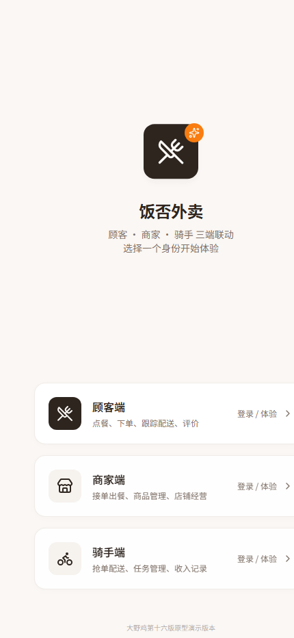

# 饭否外卖

> 顾客 / 商家 / 骑手**三端联动**的外卖点单应用。React 19 + TypeScript + Supabase（PostgreSQL），
> 数据全部落在真实数据库上：订单、聊天、钱包、会员、评价在换设备登录后依然在。

**在线演示**：<https://jianwei-57i.pages.dev/>（手机竖屏访问体验最佳）



---

## 演示账号

登录时先选身份，再填手机号；密码统一 `123456`。

| 身份 | 手机号 | 可以体验 |
|---|---|---|
| 顾客端 | `13800000001` | 浏览店铺、下单支付、跟踪配送、聊天、评价、领券、充值与开通会员 |
| 商家端 | `13800000002` | 接单出餐、菜品与分类管理、规格加料、营销活动、评价回复、财务账单 |
| 骑手端 | `13800000003` | 抢单大厅、取餐配送、任务与收入记录 |

> 演示数据由真实操作驱动——用顾客端下一单，切到商家端**不刷新**就能看到新订单。

---

## 功能特性

### 三端与订单闭环

- **9 态订单状态机**：待支付 → 待接单 → 备餐中 → 待取餐 → 配送中 → 已送达，另有已取消 / 商家拒单 / 到店自取
- **超时规则**：支付 15 分钟未完成自动取消；商家 8 分钟未接单会打上「已超时」标记，顾客可催单或取消
- **到店自取**：不进骑手抢单大厅，出餐后由商家确认「顾客已取餐」直接完成
- **拒单与取消原因**在顾客、商家、骑手三端都能看到

### 实时同步

- 顾客下单 → 商家端不刷新即见新订单；商家改价、上下架 → 顾客端不刷新即更新
- 聊天消息与会话未读数跨端实时
- 走 PostgreSQL 变更流推送（非轮询）；未配置后端或断网时自动退回手动刷新，不会白屏

### 钱包与会员

- 充值、余额支付、余额支付密码；提现流程与消费成长值
- **支付幂等**：每次支付带操作编号，配合数据库唯一约束与函数内校验——网络超时重试或快速双击都不会重复扣款
- **原子记账**：扣款、写流水、推进订单状态在一个数据库事务里完成，不会出现「扣了钱订单没变」
- **会员开通**（¥15 / 30 天）复用同一套幂等与事务保障

### 商家经营

- 菜品上下架、售罄、改价、库存
- 规格（大/中/小）与加料（辣度、口味）一次性原子保存，支持清空
- 自定义分类新增 / 重命名 / 删除（走事务函数，不留半成品数据）
- 营销活动：满减、店铺折扣、新客立减、满赠
- 财务概览与账单明细（ECharts 图表）

### 服务与社交

- 顾客↔商家、骑手↔商家即时聊天，未读数按参与方分别计数
- 通知中心：订单状态、被拒单提醒、优惠券到账
- 五星图文评价，商家可回复（数据库函数写入）
- 售后退款申请与处理、配送异常上报

---

## 技术栈

| 层面 | 选型 |
|---|---|
| 前端框架 | React 19 + TypeScript（strict，编译 0 错误） |
| 构建 | Vite 8 |
| 样式 | Tailwind CSS v4 + shadcn/ui（Radix UI） |
| 路由 | React Router v7（真实 history，任何地址都不会 404） |
| 动画 | Framer Motion（只动 transform / opacity，尊重 `prefers-reduced-motion`） |
| 图表 | ECharts |
| 后端 | Supabase：PostgreSQL + Auth + PostgREST + Realtime |
| 部署 | Cloudflare Pages（自动构建 + CDN） |
| 质量保障 | TypeScript + ESLint，提交前钩子自动跑检查 |

---

## 架构

```
页面  src/pages/*            三端各自独立的布局与路由
  ↓
业务  src/hooks/*            流程编排：订单状态机、钱包事务、聊天未读、登录态
  ↓
数据  src/data/*-remote.ts   只负责读写与字段映射
  ↓
后端  Supabase（PostgREST 查询 + RPC 事务函数 + Realtime 变更流）
  ↑
      realtime.ts 收到推送 → 通知对应模块重新拉取 → 派发事件 → 页面刷新
```

三条贯穿全项目的原则：

1. **三端严格隔离**：三套独立账号池、三套路由前缀，端内不出现跨端跳转；登录时校验角色与当前端是否匹配，不匹配立即登出。
2. **钱必须是原子的**：任何改动余额的操作都走数据库函数，扣款、流水、业务状态一次提交。
3. **失败必须可重试**：所有可能「响应丢失」的写操作都带操作编号，重试按编号幂等。

---

## 数据库设计

- **25 张表**、**57 条行级安全（RLS）策略**，以及若干事务函数：
  `pay_order_with_balance`、`purchase_membership`、`apply_wallet_txn_once`、`claim_order`、
  `reply_review`、`replace_dish_options`、`delete_custom_category`

| 领域 | 主要表 |
|---|---|
| 账号 | `profiles`（与 Supabase Auth 1:1） |
| 店铺与菜品 | `shops`、`categories`、`dishes`、`dish_spec_groups`、`dish_spec_options`、`dish_extras`、`shop_activities` |
| 订单 | `orders`、`order_items`、`addresses` |
| 钱包会员 | `wallet_transactions`、`withdraw_records`、`membership_purchases`、`point_records` |
| 消息 | `conversations`、`messages`、`notifications` |
| 互动与服务 | `reviews`、`refund_requests`、`delivery_exceptions` |
| 营销与行为 | `coupons`、`user_coupons`、`favorites`、`footprints` |

权限模型要点：商家只能改自己的店铺与菜品；顾客只能读写自己的订单、地址与钱包；骑手按订单状态抢单；
**余额不允许前端直接改**，只能通过函数修改，函数内部再校验调用者身份。

可视化 ER 图：[docs/database-design.html](docs/database-design.html)（用浏览器直接打开）

---

## 本地运行

环境要求：Node 22.x（见 `.nvmrc`）、npm 10+。

```bash
npm install
cp .env.example .env.local   # 可留空：不配置后端时会退回本地演示模式，站点照常能跑
npx vite                     # http://localhost:5173
```

**接入自己的 Supabase 实例**（可选，不接也能体验界面与本地演示流程）：

1. 建一个 Supabase 项目（区域建议新加坡/东京），在控制台把 email 确认关掉；
2. 在 SQL Editor 里**按文件名顺序**执行 `supabase/migrations/` 下的脚本——
   第一份建库结构，第二份灌演示数据，其余是各版本增量；
3. 把 Project URL 与 anon / publishable key 填进 `.env.local` 的两个变量。

自检命令：

```bash
npx tsc -p tsconfig.app.json    # 类型检查（必须 0 错误）
npx eslint src                  # 代码检查
npm run build:standalone        # 生产构建（产物在 dist/client）
npm run smoke                   # 三端冒烟（需要本机有 Chrome/Edge）
```

---

## 部署

Cloudflare Pages：

- Build command：`npm run build:standalone`
- Output directory：`dist/client`
- 环境变量：`VITE_SUPABASE_URL`、`VITE_SUPABASE_ANON_KEY`（anon key 是公开密钥，安全依赖 RLS；**不要**把 service_role 放进前端）
- `public/_redirects` 已配置 SPA 回退，刷新任意子路径都不会 404

---

## 项目结构

```
├── src/
│   ├── pages/            42 个页面模块（顾客 / 商家 / 骑手 + 登录、聊天、收银台）
│   ├── hooks/            业务逻辑：认证、订单、钱包、消息、店铺
│   ├── data/             数据层：*-remote.ts 直连 Supabase，realtime.ts 订阅变更
│   ├── components/       UI 组件（components/ui 为 shadcn/ui 基础件）
│   └── lib/              工具与 Supabase 客户端
├── supabase/
│   ├── migrations/       10 份数据库迁移（建表、演示数据、实时通道、各版本增量）
│   └── gen/              演示数据生成器与离线 SQL 校验脚本
├── scripts/              端到端脚本：三端冒烟 + 11 个业务场景
├── docs/
│   ├── database-design.html
│   └── screenshots/
└── public/images/        11 张真实菜品 / Banner 图片
```

---

## 自动化测试

测试跑在**真实浏览器 + 真实数据库**上，不是打桩：

```bash
npm run smoke                              # 三端 18 页巡检（顾客 6 + 商家 7 + 骑手 5）
node scripts/e2e-smoke.mjs scripts/e2e-rider.html rider      # 单跑某个场景
```

覆盖场景：购物车加减、登录与角色校验、商家商品管理、商家拒单、顾客被拒单提醒、
骑手主链路（抢单→取餐→配送→送达）、支付、到店自取、优惠券与钱包、钱包断网恢复、会员开通。

巡检会逐页检查「是否白屏 / 是否落进错误兜底 / 是否卡在加载中」，并收集运行期异常与 console 错误。
之所以坚持真浏览器：开发过程中有两个**类型检查与构建都发现不了**的缺陷（页面永久卡在加载、订单明细被重复写入），
只有在真机点一遍才暴露。

---

## 已知限制

1. **支付与短信是演示实现**：验证码与余额支付密码固定 `123456`；三方支付为前端模拟，只有余额支付真实扣库。代码里已预留真实接入点。
2. **图片存储**：头像与评价图片存 base64（已预留对象存储接入点），菜品图用仓库内 11 张真实图片。
3. **尚未实现**：通知中心跨设备推送、骑手位置实时同步、积分明细页。
4. **形态**：移动端竖屏网页应用，不是原生 App。

---

## 版本演进

| 版本 | 内容 |
|---|---|
| v1–v7 | 三端高保真原型 → 认证、店铺、订单、地址、评价、售后、优惠券、钱包陆续上云 |
| v8–v12 | 实时推送上线；商家端配置类写操作上云；修掉真机验收发现的 7 个缺陷；新增顾客被拒单提醒与到店自取 |
| v13 | 规格、加料与自定义分类管理接入数据库 |
| v15 | 钱包断网恢复：余额支付原子事务 + 同编号防重复记账 |
| v16 | 会员开通接入真实数据库：付款幂等、事务与边界回归 |

---

## 声明

本项目为**课程作业 / 个人作品集项目**，不用于商业运营。

- 代码：MIT License
- 菜品与 Banner 图片：来自公开素材，仅用于演示
- 支付、短信：演示实现，未接入真实服务
